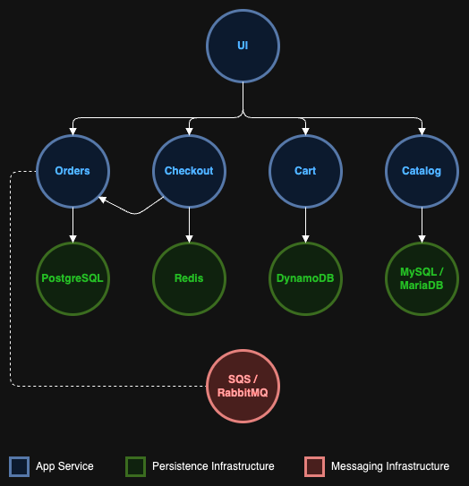

# The Store

[](https://github.com/FedeEtchegorry/Redes-TPE/actions/workflows/main.yml)

> **Redes de Información — TPE, Group 7: secure remote access to The Store.**
> [Proposal](docs/The%20Store%20-%20Acceso%20Remoto%20Seguro%20-%20Reentrega.md),
> [install, demo and runbook](infra/remote-access/README.md) and
> [implementation](infra/remote-access/IMPLEMENTATION.md).
> The application below is the unmodified upstream sample.

**The Store** is a modern e-commerce platform built with microservices architecture.

Our platform provides a complete shopping experience with:
- **Beautiful storefront** with customizable themes and responsive design
- **Scalable microservices** built with multiple languages and frameworks
- **Real-time inventory management** and order processing

## 🏗️ Architecture

The Store is built with a microservices architecture that uses different technologies:



| Service | Language | Description |
|---------|----------|-------------|
| [UI](./src/ui/) | Java (Spring Boot) | Modern web interface with themes and chat bot |
| [Catalog](./src/catalog/) | Go | Product catalog API with search and filtering |
| [Cart](./src/cart/) | Java (Spring Boot) | Shopping cart management with Redis/DynamoDB |
| [Orders](./src/orders/) | Java (Spring Boot) | Order processing and management |
| [Checkout](./src/checkout/) | Node.js (NestJS) | Checkout orchestration and payment processing |


## 🛠️ Development

### Prerequisites
- [Docker](https://docs.docker.com/get-docker/) running
- [Kind](https://kind.sigs.k8s.io/docs/user/quick-start/#installation) installed
- [Kubectl](https://kubernetes.io/docs/tasks/tools/install-kubectl/) installed

### Cluster Management

Use the `local.sh` script to manage your local Kubernetes cluster:

```bash
# Create a new cluster and deploy all services
./local.sh create-cluster

# Rebuild the entire cluster (delete and recreate)
./local.sh rebuild-cluster

# Delete the cluster
./local.sh delete-cluster

# Check cluster status
./local.sh status

# Build and load Docker images only
./local.sh reload-images
```

After running `./local.sh create-cluster`, access The Store at: **http://localhost**.

For the VPN POC, deployment on the internal VM and role-based remote access, follow
[the remote-access runbook](infra/remote-access/README.md). On `k8s-node` (`10.10.10.5`),
`./local.sh create-cluster --remote-access` uses the dedicated Kind configuration
and deploys the five internal Ingress hosts.

### Testing

#### E2E Testing

Run end-to-end tests to validate the complete system:

```bash
# Run e2e tests on existing cluster
./local.sh e2e-test
```

**Note**: These tests are run automatically when creating or rebuilding the cluster. You can skip them using the `--skip-tests` parameter for faster setup:

```bash
# Create cluster without running tests (faster setup)
./local.sh create-cluster --skip-tests

# Rebuild cluster without running tests
./local.sh rebuild-cluster --skip-tests
```

#### Load Testing
Run load generator tests to validate system performance:

```bash
# Run load generator tests
./local.sh load-test
```

The load generator will run performance tests against your local cluster for 10 minutes (or until manually stopped) to validate system behavior under load.

---

## 🔐 Secure remote access

The TPE puts The Store behind a single OpenVPN gateway. Clients authenticate with individual X.509 certificates issued by an isolated CA, and an nftables firewall lets each role reach only what it needs on the cluster node (`10.10.10.5`). A branch office connects through a site-to-site tunnel, with no VPN client on its hosts.

| Role | Tunnel IP | Reaches `10.10.10.5` |
|------|-----------|----------------------|
| dev | `10.8.0.10`-`.19` | HTTP (80) to the five services through the internal Ingress |
| sysadmin | `10.8.0.20`-`.29` | HTTP (80), SSH (22) and the Kubernetes API (6443), read-only on `the-store` |
| branch | `172.16.20.0/24` through `gw-sucursal` | HTTP (80) |

### Setup

The lab has six VirtualBox VMs (VPN gateway, CA, Kubernetes node, admin client, branch gateway and branch host). One command builds it from Git Bash:

```bash
cd infra/remote-access/scripts
bash setup-lab.sh full --no-pause
```

For a manual, step-by-step installation see [infra/remote-access/README.md](infra/remote-access/README.md).

### Validation and demo

```bash
bash eval.sh --no-pause   # runs automatic checks covering use cases CU1-CU6
bash demo.sh              # guided live demo, one use case at a time
```

The demo guide is in the [live demo section](infra/remote-access/README.md#2-live-demo) of the same README.

### Documentation

| Document | Content |
|----------|---------|
| [Proposal](docs/The%20Store%20-%20Acceso%20Remoto%20Seguro%20-%20Reentrega.md) | Design, use cases CU1-CU6 and flow matrix |
| [infra/remote-access/README.md](infra/remote-access/README.md) | Installation, live demo and runbook (revocation, renewals, tests) |
| [infra/remote-access/IMPLEMENTATION.md](infra/remote-access/IMPLEMENTATION.md) | Architecture, what was implemented and validation |

---

**The Store** - Built with ❤️ for modern e-commerce
